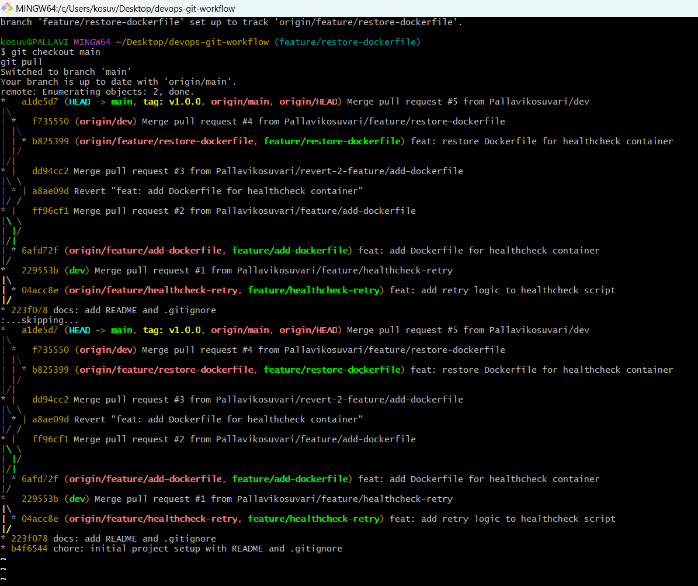
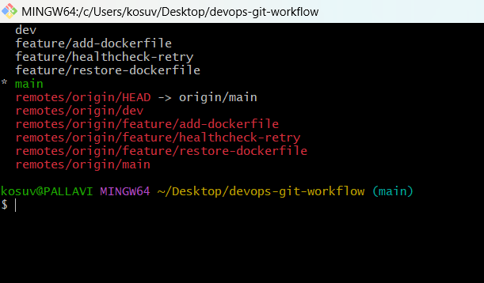
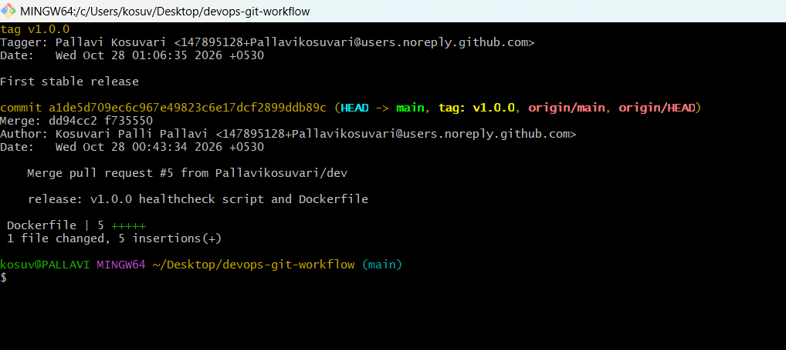
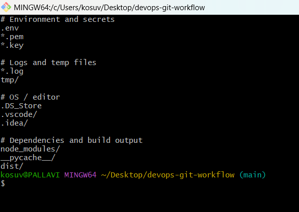
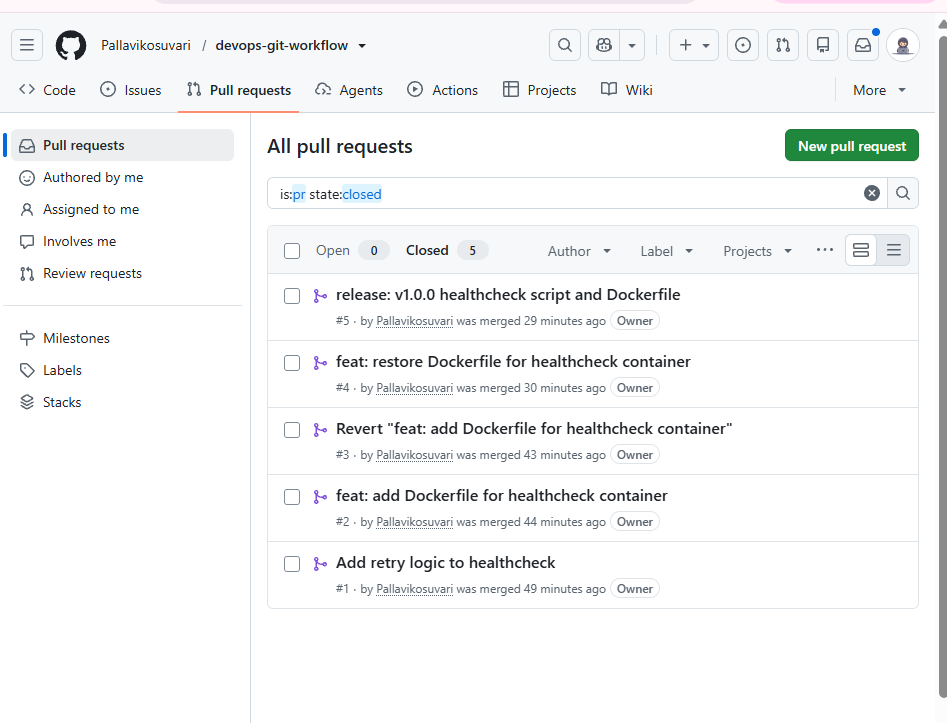
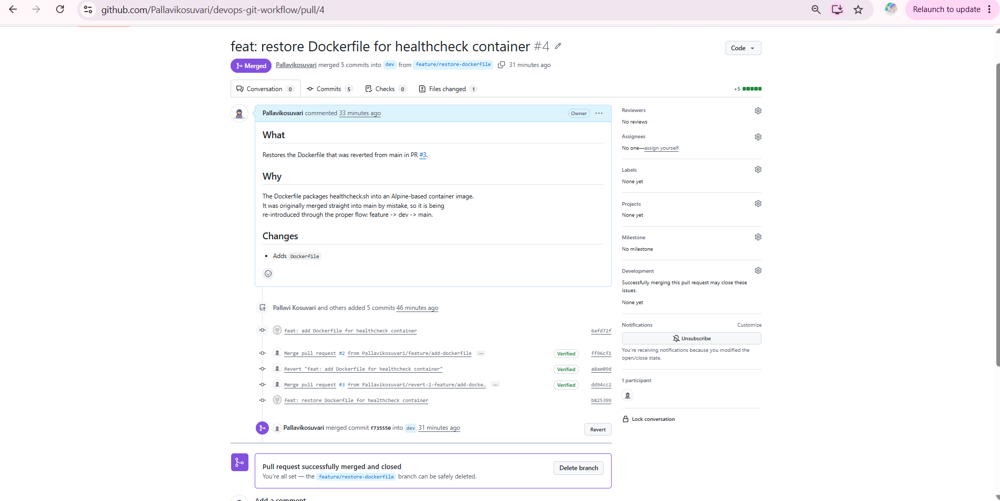
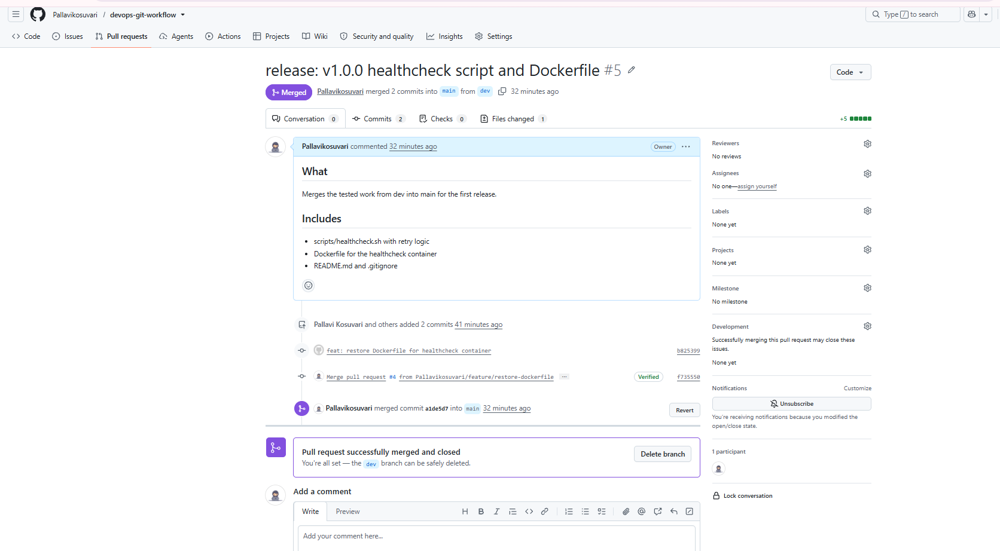
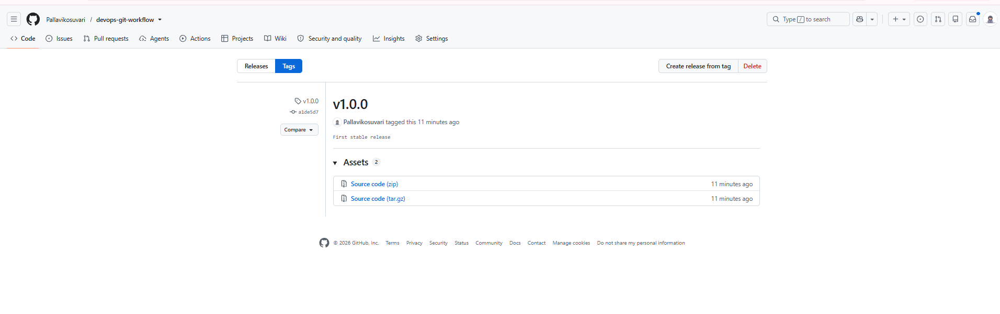

# DevOps Git Workflow

A version-controlled DevOps project that demonstrates Git best practices: branching, pull requests, tags, `.gitignore`, and documentation. This is Task 4 of the DevOps Internship.

## Project Structure

- `scripts/healthcheck.sh`: health check script with retry logic
- `Dockerfile`: packages the script into an Alpine-based container image
- `.gitignore`: files excluded from version control
- `README.md`: project documentation
- `screenshots/`: proof of the workflow

## Branching Strategy

| Branch | Purpose |
|--------|---------|
| `main` | Stable, production-ready code |
| `dev` | Integration branch where features are combined |
| `feature/*` | One branch per new feature or change |

## Workflow

1. Create a `feature/*` branch from `dev`
2. Commit changes and push the branch
3. Open a pull request into `dev` and merge it
4. Open a pull request from `dev` into `main` for a release
5. Tag the release (for example `v1.0.0`)

## What Was Done

- Initialized the repo and pushed it to GitHub
- Created `main`, `dev`, and feature branches
- Merged changes using pull requests (#1 to #5)
- Reverted a mistaken merge and restored the file through the proper flow
- Added `.gitignore` and tagged the release as `v1.0.0`

## Usage

Run the health check with: `./scripts/healthcheck.sh http://localhost:8080 3`

Build the container with: `docker build -t healthcheck .`

## Screenshots

### Branch and merge graph

### Branches

### Release tag

### .gitignore

### Pull requests

### Feature merged into dev

### Release merged into main

### Tags on GitHub
